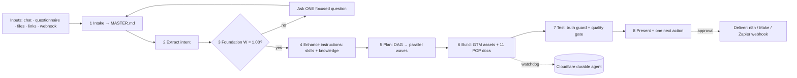

# Enably — GTM Architect

**The AI go-to-market architect.** Tell it what you sell and who buys it. It compiles your request, checks the foundation, plans the work in parallel, builds the assets (ICP, personas, positioning, use cases, email/LinkedIn/call sequences, battlecards, KPIs, playbooks, sales-ops setup, prospecting plans, n8n automations), tests them for truth and quality, and hands back **one next action**.

It is also your **SDR and sales-enablement assistant**: research accounts, find leads, verify emails, send approved emails, keep HubSpot clean, and track daily activity — with every external action waiting for your approval.

Built on **Vercel AI SDK v7** · **Cloudflare Agents** (durable runs) · **LangSmith** (tracing + evals) · **Supabase** (Postgres + RLS) · **Next.js 16**.

> This repo combines the best of every earlier Enably build into one. See [`docs/BEST-PRACTICES.md`](docs/BEST-PRACTICES.md) for what came from where.

---

## Run it in 3 steps (no keys needed)

You need [Node.js 20+](https://nodejs.org) installed.

```bash
npm install
```

```bash
npm run dev
```

Open **http://localhost:3000** → click **Open the Architect** → pick a starter prompt.

That's it. With no keys the app runs in **demo mode**: the full 8-stage pipeline runs for real, and assets come from structured templates (with every gap clearly labelled). Data is saved to `.data/enably.json` on your computer.

## Turn on the real AI (and the other "multipliers")

1. Copy the example settings file:
   ```bash
   cp .env.example .env.local
   ```
2. Open `.env.local` and paste in the keys you have. Each one unlocks something:

| Add this | You get |
|---|---|
| `AI_GATEWAY_API_KEY` (or `ANTHROPIC_API_KEY`) | Fully written, personalised assets + chat revisions with tools |
| `NEXT_PUBLIC_SUPABASE_URL` + `NEXT_PUBLIC_SUPABASE_ANON_KEY` + `SUPABASE_SERVICE_ROLE_KEY` | Sign-up / sign-in (Google + email) with private per-user data, and a real Postgres database (run `supabase/migrations/0001…0005`). **Required on Vercel** — see [`docs/DEPLOY.md`](docs/DEPLOY.md) |
| `LANGSMITH_API_KEY` | Every run traced stage-by-stage in LangSmith + eval experiments |
| `CF_AGENT_URL` + `CF_AGENT_SECRET` | Long builds & approvals survive timeouts via a Cloudflare durable agent |
| `WORKFLOW_WEBHOOK_URL` | "Send to workflow" delivers approved packages to n8n / Make / Zapier |
| `ENABLY_ACCESS_CODE` | Optional invite code required in addition to sign-in |
| `SERPAPI_API_KEY`, `APOLLO_API_KEY`, `HUNTER_API_KEY`, `HUBSPOT_ACCESS_TOKEN`, `RESEND_API_KEY` | SDR tools: research, prospecting, verification, CRM, email — see [`docs/CONNECTORS.md`](docs/CONNECTORS.md) |
| `DOCLING_URL`, `TRANSCRIBE_BASE_URL` | Scanned PDFs/tables via self-hosted Docling; audio & video transcripts via Whisper — both free to self-host ([`docs/MULTIMODAL.md`](docs/MULTIMODAL.md)) |
| `ENABLY_MCP_SERVERS` | Plug in Clay, Zoho, HubSpot, Attio or your n8n via MCP |
| `ENABLY_MCP_TOKEN` | Use Enably itself from Claude, Cursor or n8n at `/api/mcp` |

3. Stop the server (Ctrl + C) and run `npm run dev` again. **Settings** in the app shows what's connected.

## How it works — the PAL pipeline



| Stage | What happens | Code |
|---|---|---|
| Intake | Chat, files, links, questionnaire → one compiled `MASTER.md` | `lib/pal/intake.ts` |
| Extract intent | Offer, ICP, stage, motion, competitors, deliverables (rules + LLM refinement) | `lib/pal/intent.ts`, `lib/agent/refine-intent.ts` |
| Foundation | **One Must Act**: W = share of critical facts known. Below 1.00 it stops and asks — no AI spend on guesses | `lib/pal/foundation.ts` |
| Enhance instructions | System prompt + the right skills + retrieved knowledge (RAG) | `lib/agent/instruct.ts` |
| Plan | **Middle-out compressor**: dependency graph → waves that run in parallel | `lib/pal/compressor.ts` |
| Build | Specialist subagents write each asset; POP writes the 11-doc package | `lib/agent/build-asset.ts`, `lib/pal/pop.ts` |
| Test | **Calibrated truth** flags invented emails/stats/customers; quality gate scores 0–100 | `lib/pal/truth-guard.ts`, `lib/pal/quality-gate.ts` |
| Present | Summary + labelled assumptions + one next action (owner, due, proof) | `lib/agent/present.ts` |

The whole run is orchestrated in `lib/agent/pipeline.ts` and streamed to the chat by `app/api/chat/route.ts`.

## What's in the app

| Page | What it's for |
|---|---|
| `/` | Marketing landing page |
| `/app` | **Architect** — the chat agent, with a live run inspector |
| `/app/activity` | Sales activity tracker + do-not-contact list (or just say *“log 3 cold calls to Acme”*) |
| `/app/runs` | Every run's manifest: inputs, W, plan, quality, artifacts, LangSmith link |
| `/app/library` | All assets — edit, approve, copy, download `.md` |
| `/app/knowledge` | Upload PDFs, Word, PowerPoint, Excel, screenshots (OCR/vision), audio & video (transcribed), notes or links — the agent learns from all of it |
| `/app/agents` | The orchestrator, 9 specialist subagents, and the skill library |
| `/app/evals` | Eval results (from `npm run eval`) |
| `/app/settings` | Integration status + audit log |

## Folder map

```text
app/                 Pages and API routes (Next.js)
  api/chat/          The agent endpoint (streaming)
  api/runs/          Start runs from forms/webhooks; durable-agent callbacks
components/          UI (design system in app/globals.css)
lib/pal/             The deterministic PAL engine — no AI needed, fully tested
lib/agent/           AI layer: models, skills loader, tools, pipeline orchestrator
lib/db/              Database: local file store or Supabase (same interface)
lib/observability/   LangSmith tracing
lib/durable/         Client for the Cloudflare durable agent
lib/connectors/      SDR connectors (Apollo, HubSpot, Hunter, Resend…), MCP client hub
agent/               The agent's "brain" in plain Markdown/YAML — skills, instructions, agents, n8n workflows
workers/gtm-durable/ Cloudflare Agents worker (Durable Objects)
supabase/migrations/ Database schema with row-level security
evals/               Golden dataset + LangSmith eval runner
tests/               Unit tests for the engine
docs/                Architecture, best practices, roadmap, PAL process
legacy/python/       The earlier Python bootstrap (kept for reference; its tests still pass)
```

**Want to change how an asset is written?** Edit its skill in `agent/skills/<name>/SKILL.md`. No code change needed.

## Commands

| Command | What it does |
|---|---|
| `npm run dev` | Start the app locally |
| `npm test` | Unit tests for the PAL engine |
| `npm run eval` | Run the golden eval set through the real pipeline (uploads to LangSmith if keyed) |
| `npm run typecheck` | Check for type errors |
| `npm run build` | Production build |
| `npm run cf:dev` / `npm run cf:deploy` | Run / deploy the Cloudflare durable agent (run `npm install` in `workers/gtm-durable` first) |

## Docs

- [`docs/MULTIMODAL.md`](docs/MULTIMODAL.md) — documents, OCR, vision, audio & video (free stack)
- [`docs/CONNECTORS.md`](docs/CONNECTORS.md) — connectors, approvals, MCP in both directions
- [`docs/DEPLOY.md`](docs/DEPLOY.md) — Vercel, Supabase, Cloudflare, LangSmith
- [`docs/PRD-STATUS.md`](docs/PRD-STATUS.md) — the original PRD vs. what is built
- [`docs/BEST-PRACTICES.md`](docs/BEST-PRACTICES.md) — what came from which past build

## Deploy

See [`docs/DEPLOY.md`](docs/DEPLOY.md) for step-by-step Vercel, Supabase, Cloudflare and LangSmith setup.

## Safety rules (enforced in code)

- Nothing is sent, published, or written to a CRM without a human clicking **Approve**.
- Sends check the do-not-contact list and a daily cap first.
- The agent never builds on an incomplete foundation (W < 1.00).
- Invented emails, phone numbers, statistics, dollar figures and customer names are flagged.
- Secrets live only in server environment variables — never in the browser, prompts, or artifacts.
