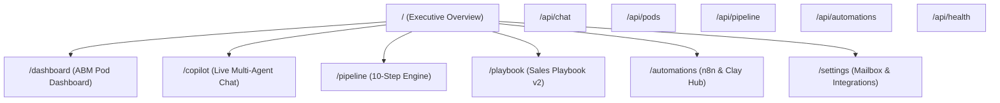

# 05. Sitemap & URL Routing Matrix

## Route Specifications

| Path | Name | Primary Intent | Auth Gate | SEO Index |
|---|---|---|---|---|
| `/` | Mission Overview | Executive overview, pod status, pipeline volume, quick launch | Public / Demo | No |
| `/dashboard` | ABM Pod Dashboard | Multi-pod metrics, funnel conversion, leak detection, mailbox health | Authenticated / Demo | No |
| `/copilot` | Live GTM Copilot | Real-time multi-agent chat, tool execution, copy approval drawer | Authenticated / Demo | No |
| `/pipeline` | 10-Step Engine | Visual execution tracker for daily steps (signal to sequence) | Authenticated / Demo | No |
| `/playbook` | Sales Playbook | Interactive Playbook v2, battlecards, persona guides, claims | Public / Authenticated | No |
| `/automations` | Automations Hub | Production n8n workflows, Clay recipes, Salesforce field schemas | Authenticated / Demo | No |
| `/settings` | System Settings | Mailbox rotation pool, API credentials, telemetry | Admin / Demo | No |
| `/api/chat` | AI Chat API | Vercel AI SDK v7 streaming endpoint with tool calling | Bearer / Session | No |
| `/api/pods` | Pod Metrics API | Data provider for accounts, funnels, mailboxes, and leaks | Bearer / Session | No |
| `/api/pipeline` | Pipeline Runner API | Triggers individual or batched pipeline steps | Bearer / Session | No |
| `/api/automations` | Workflow Asset API | Returns n8n JSONs, Clay schemas, and CSV templates | Bearer / Session | No |
| `/api/health` | Health & Readiness | Uptime, Supabase status, and model gateway connectivity | Public | No |
