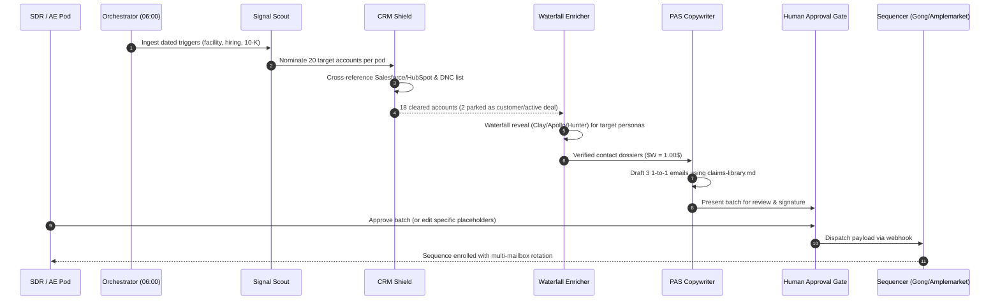

# 06. User Flows & State Transitions: Loadsmart GTM Agent OS

## 1. Daily 10-Step Deterministic Flow

## 2. Account Lifecycle States

| State | Definition | Next Permitted Transition |
|---|---|---|
| `NOMINATED` | Identified by Signal Scout; pending CRM Shield check. | `PARKED_CRM_COLLISION` or `CRM_CLEARED` |
| `PARKED_CRM_COLLISION` | Active customer or existing open opportunity in Salesforce. | None (Requires RevOps manual override) |
| `CRM_CLEARED` | Verified no conflicts; ready for contact reveal. | `ENRICHING` |
| `ENRICHED` | Target persona discovered and email syntax/deliverability validated. | `RESEARCHING` or `DISQUALIFIED_NO_BUYER` |
| `RESEARCHED` | Account intelligence brief compiled ($W = 1.00$). | `COPY_DRAFTED` |
| `COPY_DRAFTED` | 1-to-1 PAS copy staged; waiting in human approval drawer. | `APPROVED` or `REJECTED_NEEDS_EDIT` |
| `APPROVED` | Signed off by pod AE/SDR. | `SEQUENCED` |
| `SEQUENCED` | Enrolled in Gong Engage / Amplemarket sequence. | `REPLIED`, `MEETING_BOOKED`, or `UNRESPONSIVE_14D` |
| `MEETING_BOOKED` | Converted to qualified sales opportunity. | `PIPELINE_WON` or `PIPELINE_LOST` |
