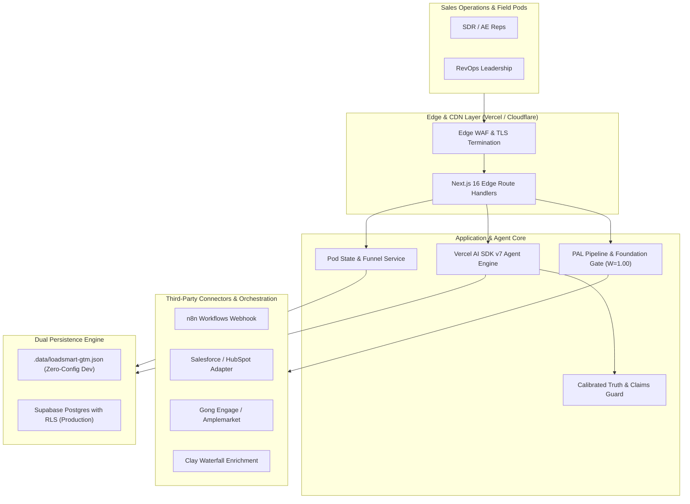

# 10. System Architecture: Loadsmart Live GTM Agent OS

## 1. High-Level C4 Architecture (L1 & L2)

## 2. Component Design & Responsibilities

1. **Vercel AI SDK v7 Streaming Engine:** Orchestrates streaming dialog with clients via `@ai-sdk/react` (`useChat`), handles tool execution loops, and supports dynamic model swapping (Google Gemini 2.5 / Flash + Anthropic Claude 3.5 Sonnet) with offline demo simulation.
2. **Deterministic 10-Step Pod Pipeline:** Enforces sequential transition of 20 accounts per pod:
   - `06:00` `la-signal`
   - `06:30` `la-crm-audit`
   - `07:00` `la-abm-tag`
   - `07:15` `la-persona-enrich`
   - `07:45` `la-research`
   - `08:15` `la-email`
   - `08:30` `la-sequence` (Human Approval Gate)
   - `17:00` `la-daily-report`
3. **Calibrated Truth Guard:** Intercepts drafted touchpoints and validates every quantitative claim against `knowledge/claims-library.md`. Prevents AI hallucination of unsupported ROI or fake shipper logos.
4. **Dual Persistence Layer:**
   - Development & Evaluation: Fast, atomic local file database in `.data/loadsmart-gtm.json`.
   - Production Cloud: Supabase Postgres instance secured by Row Level Security (RLS) on `pod_id` and `user_id`.
