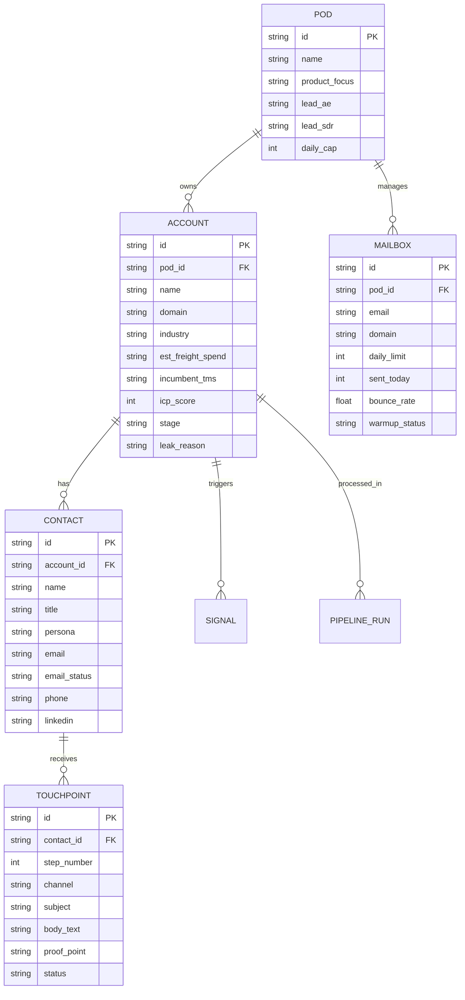

# 12. Data Model & Schema: Loadsmart GTM Agent OS

## 1. Entity Relationship Diagram (ERD)



## 2. Supabase SQL Migrations (Production DDL)

```sql
create table if not exists gtm_pods (
  id text primary key,
  name text not null,
  product_focus text not null,
  lead_ae text not null,
  lead_sdr text not null,
  daily_cap integer default 20,
  created_at timestamptz default now()
);

create table if not exists gtm_accounts (
  id uuid primary key default gen_random_uuid(),
  pod_id text references gtm_pods(id) on delete cascade,
  name text not null,
  domain text not null,
  industry text,
  est_freight_spend text,
  incumbent_tms text,
  icp_score integer default 0,
  stage text default 'NOMINATED',
  leak_reason text,
  metadata jsonb default '{}'::jsonb,
  created_at timestamptz default now()
);

create table if not exists gtm_contacts (
  id uuid primary key default gen_random_uuid(),
  account_id uuid references gtm_accounts(id) on delete cascade,
  name text not null,
  title text not null,
  persona text not null,
  email text,
  email_status text default 'PENDING',
  phone text,
  linkedin text,
  created_at timestamptz default now()
);

create table if not exists gtm_touchpoints (
  id uuid primary key default gen_random_uuid(),
  contact_id uuid references gtm_contacts(id) on delete cascade,
  step_number integer not null,
  channel text default 'EMAIL',
  subject text,
  body_text text not null,
  proof_point text,
  status text default 'DRAFTED',
  created_at timestamptz default now()
);

create table if not exists gtm_mailboxes (
  id text primary key,
  pod_id text references gtm_pods(id) on delete cascade,
  email text not null,
  domain text not null,
  daily_limit integer default 40,
  sent_today integer default 0,
  bounce_rate numeric(4,2) default 0.00,
  warmup_status text default 'HEALTHY',
  updated_at timestamptz default now()
);

alter table gtm_pods enable row level security;
alter table gtm_accounts enable row level security;
alter table gtm_contacts enable row level security;
alter table gtm_touchpoints enable row level security;
alter table gtm_mailboxes enable row level security;
```
