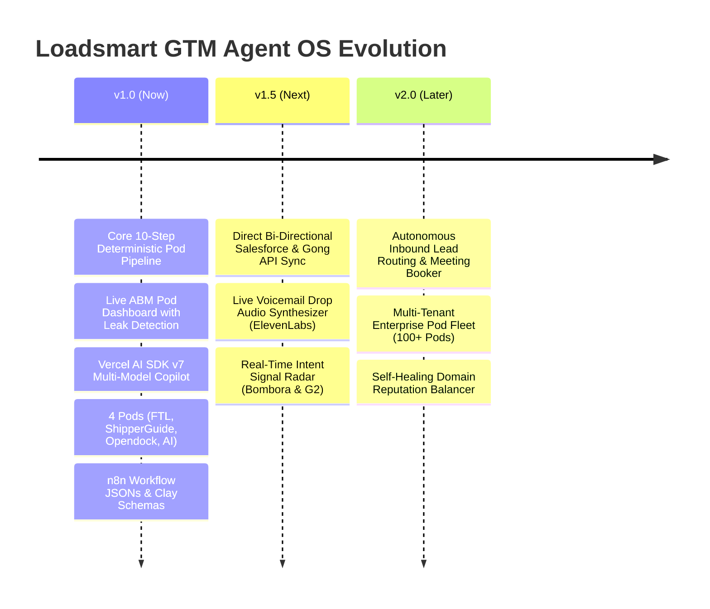

# 19. Product Roadmap: Loadsmart GTM Agent OS

## Milestone Objectives
- **v1.0 (Current):** Single pane of glass for 4 pods, 20 accounts daily, zero-hallucination copy, and full Site Empire OS documentation.
- **v1.5 (Q1 2027):** Automated calendar booking integrations, Gong Engage direct sync without manual CSVs, dynamic AI voice drops.
- **v2.0 (Q2 2027):** Inbound web lead enrichment and autonomous reply classification.
